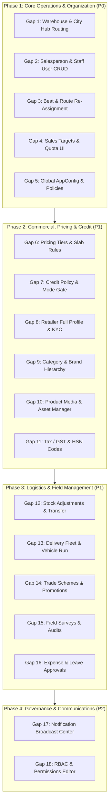

# GAGAN Admin Front-End Web UI: 18 Operational Gaps & Phased Implementation Roadmap

> **Objective:** Eliminate all operational dependencies on direct code modifications, Prisma seed scripts, and Render environment adjustments. Empower business operations, sales leadership, warehouse managers, and account teams to manage the entire platform directly through the web-based Admin Portal (`https://gagan-client-uat-admin.onrender.com`).

---

## Executive Summary & Architecture Principles

Currently, several mission-critical operational parameters—such as fulfillment warehouse routing, salesperson profiles, target definitions, and delivery thresholds—rely on backend scripts, database queries, or server-level configuration. 

This document defines the complete scope, technical requirements, and execution phases for **all 18 identified functional gaps**. 

---

## Phase 1: Core Operations & Organization (Immediate P0)
*Focus: Sales force identity, daily targets, fulfillment hub assignment, and essential business rules.*

---

### Gap 1: Warehouse & Multi-Hub City Routing Manager
* **Business Need:** When expanding to new cities (e.g. Bhopal, Jabalpur) or changing fulfillment logistics, admins must map delivery cities and pincodes to specific warehouses without touching code or redeploying backend services.
* **Current Bottleneck:** Warehouse associations and delivery city lists are hardcoded or manually populated via seed scripts (`setupFreshSalesWarehouseCluster.ts`).
* **Admin Web UI Requirements:**
  - **Warehouse Management View:** Create, edit, and deactivate warehouses with name, code, physical address, contact manager, and operational status.
  - **Fulfillment Routing Table:** City-to-warehouse mapping matrix. Ability to assign one or multiple cities/pincodes to a primary and fallback warehouse.
  - **Auto-Routing Engine:** Incoming retailer orders automatically route to the warehouse mapped to the retailer's delivery city.
* **Database Models:** `Warehouse`, `StorageLocation`, `DeliveryZone`, `CityRouting`.

---

### Gap 2: Salesperson & Staff User Management (Full CRUD)
* **Business Need:** Business owners must add new field reps, edit names (e.g., updating Vikram Singh to Vikas Bhimke), update phone numbers, deactivate departed staff, and manage roles directly via the web.
* **Current Bottleneck:** Staff profiles and phone numbers require direct database updates or Prisma seeds.
* **Admin Web UI Requirements:**
  - **Staff Directory Page:** Filterable list of all employees showing role, phone number, reporting manager, linked SalesRep profile, and status (Active/Suspended).
  - **Add/Edit Staff Modal:**
    - Full Name, Mobile Phone (validated Indian 10-digit number), Official Email.
    - Role selector (`salesperson`, `field_manager`, `warehouse_manager`, `accounts`, `admin`).
    - Reporting Manager dropdown (hierarchical tree).
    - Sales Territory input.
  - **One-Click Deactivation:** Revoke active JWT device sessions immediately upon deactivation.
* **Database Models:** `StaffUser`, `SalesRep`, `StaffRole`, `DeviceSession`.

---

### Gap 3: Sales Territory, Beat & Route Re-Assignment
* **Business Need:** When a salesperson is on leave, leaves the company, or territories are realigned, their assigned retailers must be reassigned in bulk to another rep without running SQL queries.
* **Current Bottleneck:** Retailer `salesRepId` is updated through custom migration scripts.
* **Admin Web UI Requirements:**
  - **Territory & Beat Builder:** Create named beats (e.g., "Indore Central Kirana Cluster", "Ujjain Road Beat") with recurring schedule (Monday/Thursday visits).
  - **Bulk Retailer Reassignment Tool:** Select multiple retailers with checkboxes, choose the target salesperson, and click "Transfer Assignment".
  - **Map-Based Cluster View:** Visual map displaying pinned retailers color-coded by assigned salesperson.
* **Database Models:** `BeatTemplate`, `BeatTemplateStop`, `RoutePlan`, `Retailer`.

---

### Gap 4: Sales Targets & Quota Dashboard Editor
* **Business Need:** Sales heads need to set and adjust daily, monthly, and quarterly revenue and order count targets for each salesperson through the web UI.
* **Current Bottleneck:** Targets are generated via seed scripts or raw database inserts; no frontend editor exists.
* **Admin Web UI Requirements:**
  - **Target Setting Matrix:** Table showing all active salespeople with editable columns for Today's Target (₹), Monthly Target (₹), and Target Order Count.
  - **Bulk Target Import/Export:** Upload monthly Excel/CSV sheet with columns `[Phone, Month, TargetAmount, MinOrders]`.
  - **Real-Time Target Progress View:** View current achievement percentage vs target for any selected date range.
* **Database Models:** `SalesTarget`, `AchievementEvent`.

---

### Gap 5: Global App Configuration & Policy Controls (`AppConfig`)
* **Business Need:** Non-technical administrators must modify business rules like minimum order value and support phone number without code changes or redeployments.
* **Current Bottleneck:** Values are stored in `AppConfig` singleton or environment variables with no UI to change them.
* **Admin Web UI Requirements:**
  - **Settings > Business Rules Panel:**
    - Minimum Order Value (₹) input field.
    - Free Delivery Threshold (₹) input field.
    - Customer Support Phone Number & Helpdesk WhatsApp.
  - **Field Sales Policy Toggles:**
    - Require Attendance Selfie (ON/OFF).
    - Salesperson GPS Location Tracking (ON/OFF).
    - Location Ping Interval (dropdown: 60s, 180s, 300s, 600s).
* **Database Models:** `AppConfig`.

---

## Phase 2: Commercial, Pricing & Credit Control (High P1)
*Focus: Dynamic pricing, credit rollout management, retailer onboarding, and catalog taxonomy.*

---

### Gap 6: Pricing Tier & Slab Rule Editor
* **Business Need:** Commercial teams need to create customer tiers (Platinum, Gold, Silver, Standard), adjust tier margins, and configure quantity slab discounts (e.g., 50+ bags = 3% extra discount).
* **Admin Web UI Requirements:**
  - Create, rename, and manage pricing tiers.
  - Tier discount percentage or absolute price override per SKU variant.
  - Quantity slab rules (Min Qty, Max Qty, Discount %).
* **Database Models:** `Tier`, `PriceList`, `PriceOverride`.

---

### Gap 7: Credit Policy & Mode Gate (`shadow` vs `enforced`)
* **Business Need:** Finance teams must manage credit risk without requiring engineering intervention to toggle enforcement modes.
* **Admin Web UI Requirements:**
  - System-wide credit mode selector: `shadow` (monitoring only) vs `enforced` (blocks checkout when credit exceeded) vs `disabled`.
  - Retailer Credit Limit Override Modal with manager approval workflow.
  - Credit Aging & Overdue Payment Terms Editor (7, 14, 21, 30 days).
* **Database Models:** `CreditPolicyVersion`, `CreditProfile`, `AppConfig`.

---

### Gap 8: Full Retailer Profile & KYC Master Editor
* **Business Need:** Admins must edit shop names, contact persons, phone numbers, addresses, and approve KYC documents directly.
* **Admin Web UI Requirements:**
  - Full editable retailer details: Shop Name, Trade Name, Owner Name, Mobile Phone, GSTIN, PAN, Address, Pincode.
  - KYC verification drawer: View uploaded Aadhaar/GST certificates, click "Approve" or "Reject with Reason".
  - GPS Coordinate Pinpoint: View shop location on Google Maps and adjust pin if needed.
* **Database Models:** `Retailer`, `KycCase`, `KycDocument`, `RetailerLocation`.

---

### Gap 9: Catalog Category & Brand Hierarchy Master
* **Business Need:** Add new product categories (e.g. Pulses/Daal, Spices, Grains, Instant Mixes), reorder them, and assign marketing banners.
* **Admin Web UI Requirements:**
  - Category tree editor: Add, edit, reorder categories and subcategories.
  - Brand manager: Add brand logos and brand descriptions.
  - Visual sort order controls (drag to reorder display on mobile app).
* **Database Models:** `Category`, `Brand`, `Product`.

---

### Gap 10: Product Media & Asset Manager
* **Business Need:** Directly upload, replace, or reorder product images from the browser so product cards never show blank or missing images.
* **Admin Web UI Requirements:**
  - Drag-and-drop image uploader with direct S3/Cloudflare R2 integration.
  - Automatic image compression and thumbnail generation.
  - Set Primary/Hero image and manage gallery carousel photos.
  - Broken image detector and missing image warning badge.
* **Database Models:** `Product`, `Variant`, `EvidenceAsset`.

---

### Gap 11: Tax / GST Rates & HSN Code Master
* **Business Need:** Manage GST percentages (0%, 5%, 12%, 18%) and HSN codes when government tax brackets change.
* **Admin Web UI Requirements:**
  - HSN code lookup and configuration table.
  - Tax slab assignment per variant (CGST, SGST, IGST calculation preview).
  - Tax exemption toggle for specific commodity lines.
* **Database Models:** `Variant`, `OrderItem`, `InvoiceLine`.

---

## Phase 3: Logistics, Field Sales & Operations (P1)
*Focus: Warehouse inventory control, fleet dispatch, trade promotions, and field team management.*

---

### Gap 12: Inventory Stock Adjustments & Transfer Manager
* **Business Need:** Warehouse managers must perform manual stock adjustments (breakage, damage, physical stock audit) and record inter-warehouse transfers.
* **Admin Web UI Requirements:**
  - Stock Adjustment Form: Select Warehouse + SKU + Adjustment Type (Receipt, Spoilage, Discrepancy) + Quantity + Reason Note.
  - Stock Transfer Order: Move stock from Warehouse A to Warehouse B with In-Transit status.
  - Low-stock threshold alert configuration.
* **Database Models:** `InventorySnapshot`, `StockMovement`, `Warehouse`.

---

### Gap 13: Delivery Fleet & Vehicle Run Dispatcher
* **Business Need:** Logistics leads must manage delivery vehicles (tempo, truck, 3-wheeler) and assign driver runs (`RUN-001`, etc.) with ETA tracking.
* **Admin Web UI Requirements:**
  - Vehicle & Driver Master: Add vehicle registration numbers, vehicle capacity (Kg/Bags), and driver contact details.
  - Run Dispatcher: Group packed orders into a single delivery run, assign driver, and generate loading sheet.
  - Delivery Run Status Tracker: Loaded -> Out for Delivery -> Completed.
* **Database Models:** `Delivery`, `Order`, `Warehouse`.

---

### Gap 14: Customer Schemes & Trade Promotion Engine
* **Business Need:** Marketing and sales managers need to launch promotions (e.g. "Buy 10 bags of Toor Dal, get 1 bag free" or "₹500 off on ₹15,000 order").
* **Admin Web UI Requirements:**
  - Scheme Creator: Scheme Title, Description, Validity Start/End Dates.
  - Rule Builder: Minimum order value or minimum quantity trigger.
  - Reward Definition: Free goods (FOC), flat discount, or percentage rebate.
  - Target Audience: All retailers, specific tier, or specific territory.
* **Database Models:** `Scheme`, `OrderItem`.

---

### Gap 15: Market Surveys & Field Task Creator
* **Business Need:** Sales heads need to push audit tasks to salespeople's mobile apps (e.g. competitor price check, brand board visibility photo).
* **Admin Web UI Requirements:**
  - Survey Form Builder: Add question types (Single Choice, Multi-Choice, Number Input, Photo Required).
  - Assignment Rules: Assign to specific beats, tiers, or all field visits.
  - Response Explorer: View submitted answers and geotagged audit photos.
* **Database Models:** `Survey`, `SurveyQuestion`, `SurveyAssignment`, `FieldTask`.

---

### Gap 16: Salesperson Expense & Leave Approvals Portal
* **Business Need:** Field managers need to review daily fuel/travel expense claims and approve leave requests submitted by reps from their phones.
* **Admin Web UI Requirements:**
  - Expense Claims Inbox: List pending claims with date, amount, category (Fuel, Food, Lodging), and receipt photo preview.
  - One-Click Approve / Reject with explanation note.
  - Leave Request Calendar: View team calendar and approve leave days.
* **Database Models:** `FieldExpense`, `LeaveRequest`, `WorkdaySession`.

---

## Phase 4: Governance & Communications (P2)
*Focus: Broadcast communications and granular role-based security.*

---

### Gap 17: Notification & Broadcast Center
* **Business Need:** Announce price changes, holiday notices, and seasonal schemes to all field reps or retailers without manual calls.
* **Admin Web UI Requirements:**
  - Compose Broadcast: Title, Body message, Priority (Normal/Urgent).
  - Target Segment: All Salespeople, All Retailers, or Selected City.
  - Channels: In-App Banner, Mobile Push Notification, and SMS.
* **Database Models:** `Notification`, `AuditEvent`.

---

### Gap 18: Role-Based Access Control (RBAC) & Permissions Editor
* **Business Need:** Super-admins must define custom internal roles and assign granular page/action permissions without changing code files.
* **Admin Web UI Requirements:**
  - Role Manager: Create custom role (e.g. "Regional Accounts Lead").
  - Permissions Matrix: Interactive checkbox table by module (Orders, Retailers, Pricing, Warehouse, Reports) and actions (View, Create, Edit, Approve, Export).
  - Audit Trail Log: Timestamped record of which admin modified which setting.
* **Database Models:** `Role`, `Permission`, `RolePermission`, `AuditEvent`.

---

## Implementation Phasing & Milestones

| Phase | Focus Areas | Gaps Covered | Estimated Sprint | Primary Users |
|---|---|---|---|---|
| **Phase 1 (P0)** | **Core Organization & Rules** | Gaps 1, 2, 3, 4, 5 | Sprint 1 | Ops Lead, Sales Head |
| **Phase 2 (P1)** | **Commercial & Catalog** | Gaps 6, 7, 8, 9, 10, 11 | Sprint 2 | Pricing Analyst, Category Mgr, KYC Officer |
| **Phase 3 (P1)** | **Logistics & Field Force** | Gaps 12, 13, 14, 15, 16 | Sprint 3 | Warehouse Lead, Fleet Manager, Field Mgr |
| **Phase 4 (P2)** | **Governance & Broadcasts**| Gaps 17, 18 | Sprint 4 | Executive Admin, HR / Compliance |

---

## Ready for Next Prompt Action

This roadmap is finalized and structured for direct execution. In the next prompt, you can trigger implementation by specifying the target phase (e.g. *"Let's implement Phase 1: Gaps 1 to 5"*), and the corresponding frontend pages, backend REST APIs, and database migrations will be built systematically without disrupting any live features.
